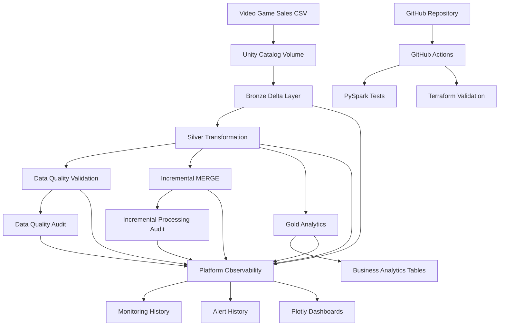

# Video Game Sales Data Engineering & Platform Observability

An end-to-end data engineering project built with **Databricks, Apache Spark, PySpark, Delta Lake, Unity Catalog, Terraform and GitHub Actions**.

The project transforms video game sales data into analytical datasets through a layered data architecture, implements incremental processing and data quality validation, and provides platform monitoring and operational observability.

## Project Overview

This project started as a video game sales analysis using Apache Spark and has evolved into a Databricks data engineering platform.

It processes 16,598 video game sales records through Bronze, Silver and Gold layers, supports incremental data processing using Delta MERGE, and provides monitoring capabilities for pipeline health, data quality, transaction history and processing operations.

## Architecture



For detailed architecture and implementation boundaries, see [Architecture Documentation](docs/architecture.md).

## Technology Stack

| Category | Technologies |
|---|---|
| Data processing | Apache Spark, PySpark, Spark SQL |
| Data platform | Databricks |
| Storage | Delta Lake |
| Data governance | Unity Catalog |
| Programming | Python, SQL, Scala |
| Data quality | PySpark, pytest |
| Visualization | Plotly |
| Infrastructure as Code | Terraform |
| CI/CD | GitHub Actions |
| Version control | Git, GitHub |

## Data Pipeline

The project follows a Medallion Architecture.

### 1. Bronze Layer — Raw Ingestion

- Ingests source CSV records into a Spark DataFrame.
- Preserves original source columns and values.
- Captures source file path and ingestion timestamp.
- Stores the ingested dataset as a Delta table.

**Table:** `bronze_video_game_sales`

### 2. Silver Layer — Transformation

- Standardizes column names.
- Trims text fields.
- Converts valid release years into integers.
- Identifies missing and invalid year values.
- Calculates regional sales totals.
- Evaluates differences between regional and reported global sales.

**Table:** `silver_video_game_sales`

### 3. Data Quality and Validation

Implements SQL and PySpark-based data quality checks.

Checks include:

- Record count validation.
- Valid and invalid release-year counts.
- Null-year detection.
- Sales reconciliation.
- Record-level consistency.

Audit results are stored in:

`data_quality_audit`

### 4. Gold Layer — Business Analytics

Creates five analytical Delta tables:

| Table | Purpose |
|---|---|
| `gold_sales_by_year` | Sales trends by release year |
| `gold_sales_by_platform` | Platform performance |
| `gold_sales_by_genre` | Genre performance |
| `gold_sales_by_region` | Regional sales distribution |
| `gold_top_games` | Top-selling games |

### 5. Incremental Processing

Implements Delta Lake MERGE-based incremental processing.

Capabilities demonstrated:

- Initial target population.
- SHA-256 record fingerprinting.
- Insert and update detection.
- Idempotent reruns.
- Controlled insert/update validation.
- Processing audit logging.
- Source-to-target reconciliation.

**Target table:** `incremental_video_game_sales`

**Audit table:** `incremental_processing_audit`

The implementation uses a full Silver snapshot as its MERGE source. It demonstrates incremental change detection but does not implement CDC or watermark-based extraction.

## Platform Observability

The project includes a dedicated observability notebook that monitors pipeline health and operational behaviour.

### Monitoring Capabilities

- Bronze, Silver, Incremental and Gold record counts.
- Layer-to-layer record reconciliation.
- Historical data quality results.
- Incremental processing history.
- Delta Lake transaction history.
- MERGE execution metrics.
- Rule-based platform health checks.
- Persistent monitoring and alert evaluation history.

### Persistent Monitoring Tables

| Table | Purpose |
|---|---|
| `platform_monitoring_history` | Timestamped platform health snapshots |
| `platform_alert_history` | Historical alert evaluations |

### Interactive Dashboards

Plotly visualizations cover:

1. Pipeline record-count monitoring.
2. Data quality pass/fail history.
3. Incremental processing metrics.
4. Delta Lake MERGE execution times.
5. Gold analytics table volumes.
6. Historical monitoring and alert evaluations.

The current implementation provides notebook-driven monitoring and rule-based alert evaluation. Automated email, Slack or PagerDuty notifications are not implemented.

## Infrastructure as Code and CI/CD

Terraform configuration is included to manage the Databricks platform observability job.

The configuration demonstrates:

- Databricks job resource definition.
- GitHub-backed notebook execution.
- Retry configuration.
- Execution timeout.
- Concurrency control.
- Resource tagging.

Terraform has passed automated formatting and validation checks. It has not yet been applied to a live workspace.

### GitHub Actions

Two automated workflows are configured:

| Workflow | Responsibility |
|---|---|
| Databricks Data Pipeline CI | PySpark unit tests |
| Terraform Infrastructure CI | Terraform formatting, initialization and validation |

These workflows provide automated quality checks for application code and infrastructure configuration.

## Project Results

| Metric | Result |
|---|---:|
| Source records processed | 16,598 |
| Valid release years | 16,327 |
| Missing or invalid release years | 271 |
| Gold analytical tables | 5 |
| Data quality checks per run | 6 |
| Controlled incremental test | 1 insert, 1 update |
| Initial incremental load | 16,598 records |

### Selected Analytical Findings

- PlayStation 2 recorded approximately 1,255.64 million global sales.
- Action was the leading genre with approximately 1,751.18 million global sales.
- Wii Sports was the top-selling game with approximately 82.74 million global sales.

## Repository Structure

```text
Video-Game-Sales-Data-Analysis-with-Apache-Spark/
│
├── notebooks/
│   ├── 00_environment_validation
│   ├── 01_bronze_ingestion
│   ├── 02_silver_transformation
│   ├── 03_data_quality
│   ├── 04_gold_analytics
│   ├── 05_incremental_processing
│   └── 06_platform_observability
│
├── src/
│   ├── ingestion/
│   ├── transformations/
│   ├── quality/
│   └── utilities/
│
├── tests/
│   ├── conftest.py
│   ├── test_transformations.py
│   └── test_data_quality.py
│
├── docs/
│   ├── architecture.md
│   ├── platform_monitoring.md
│   ├── operations_runbook.md
│   └── access_control.md
│
├── infra/
│   └── terraform/
│       └── observability-job/
│
├── .github/
│   └── workflows/
│       ├── databricks-ci.yml
│       └── terraform-ci.yml
│
├── requirements-dev.txt
├── pytest.ini
├── README.md
└── video_game_sales.csv
```

## How to Run

### Prerequisites

- Databricks workspace.
- Access to a Unity Catalog-enabled catalog and schema.
- GitHub repository connected to Databricks.
- Python and PySpark environment for local unit testing.
- Java 17 for Spark 4.x local testing.
- Terraform CLI for infrastructure validation.

### Execution Sequence

Execute the Databricks notebooks in order:

1. `00_environment_validation`
2. `01_bronze_ingestion`
3. `02_silver_transformation`
4. `03_data_quality`
5. `04_gold_analytics`
6. `05_incremental_processing`
7. `06_platform_observability`

The observability notebook assumes that the preceding pipeline tables and audit tables already exist.

### Unit Tests

Install development dependencies:

```bash
pip install -r requirements-dev.txt
```

Run:

```bash
pytest -v
```

### Terraform Validation

```bash
cd infra/terraform/observability-job
terraform init -backend=false
terraform fmt -check
terraform validate
terraform plan
```

Review the plan and workspace configuration before considering deployment.

## Implementation Scope and Limitations

This project was developed using Databricks Free Edition.

It demonstrates data engineering, Delta Lake processing, data quality validation, platform monitoring, automated testing and infrastructure configuration.

The following enterprise capabilities are not claimed as implemented:

- Production workspace administration.
- Cloud infrastructure provisioning.
- Production compute and cost management.
- Automated notification integrations.
- Production scheduling and job orchestration.
- CDC and watermark-based ingestion.

## Author

**Manoj Gangula**

GitHub: [Manojgangula20](https://github.com/Manojgangula20)
