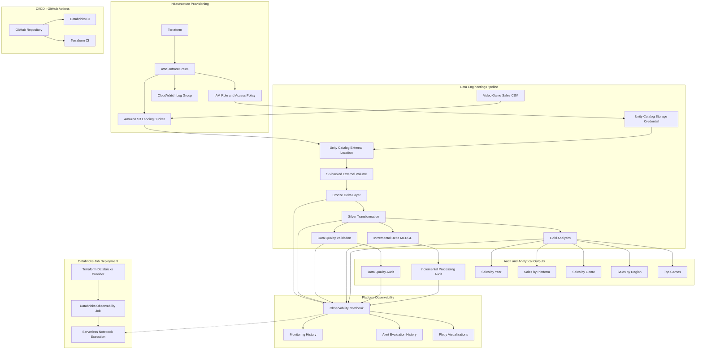
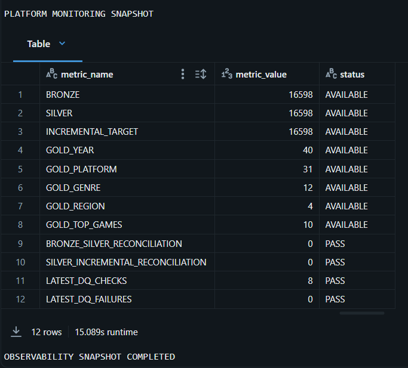

# Video Game Sales Data Engineering & Platform Observability

An end-to-end data engineering platform built with **Databricks, Apache Spark, PySpark, Delta Lake, Unity Catalog, AWS, Terraform and GitHub Actions**.

This project transforms 16,598 video game sales records into analytical datasets through a Medallion architecture. It implements data quality validation, incremental processing, platform observability, AWS infrastructure provisioning and Terraform-managed Databricks job deployment.

## Project Overview

Originally developed as a video game sales analysis using Apache Spark, this project evolved into a cloud-integrated Databricks data engineering platform.

The platform demonstrates:

- AWS S3-backed data ingestion through Databricks Unity Catalog.
- Bronze, Silver and Gold data processing layers.
- Delta Lake MERGE-based incremental processing.
- Automated data quality checks and audit logging.
- Pipeline health monitoring and operational observability.
- Terraform-managed AWS infrastructure and Databricks jobs.
- GitHub Actions CI for automated testing and infrastructure validation.

**Execution status:** The data pipeline and observability notebook have been executed successfully. AWS infrastructure and the Databricks observability job have been deployed and verified.

## Architecture



For detailed architecture and implementation boundaries, see [Architecture Documentation](docs/architecture.md).

## Technology Stack

| Category | Technologies |
|---|---|
| Data processing | Apache Spark, PySpark, Spark SQL |
| Data platform | Databricks |
| Storage | Delta Lake, AWS S3 |
| Data governance | Unity Catalog |
| Programming | Python, SQL |
| Data quality | PySpark, pytest |
| Visualization | Plotly |
| Cloud infrastructure | AWS IAM, S3, CloudWatch |
| Infrastructure as Code | Terraform |
| CI/CD | GitHub Actions |
| Version control | Git, GitHub |

## 📊 Platform Observability

The platform includes monitoring for pipeline execution, data quality,
incremental processing, and cross-layer reconciliation.



## Data Pipeline

The project follows the Medallion Architecture.

### 1. Bronze Layer — Raw Ingestion

- Reads source CSV data from an S3-backed Unity Catalog Volume.
- Preserves original source columns and values.
- Captures source file path and ingestion timestamp.
- Stores ingested records as a Delta table.

**Table:** `bronze_video_game_sales`

**Verified records:** 16,598

### 2. Silver Layer — Transformation

- Standardizes column names.
- Trims text fields.
- Converts valid release years into integers.
- Identifies missing and invalid release-year values.
- Calculates regional sales totals.
- Evaluates differences between regional and reported global sales.

**Table:** `silver_video_game_sales`

**Transformation results:**
- 16,327 records with valid release years.
- 271 records with missing or invalid release years.
- Maximum observed sales reconciliation difference: 0.02.

### 3. Data Quality and Validation

Implements SQL and PySpark-based data quality checks.

Checks include:

- Record count validation.
- Valid and invalid release-year counts.
- Null-year detection.
- Sales reconciliation.
- Record-level consistency.
- Cross-layer consistency checks.

Audit results are stored in:

`data_quality_audit`

The latest observed monitoring results reported **8 passing checks and 0 failures**.

### 4. Gold Layer — Business Analytics

Creates five analytical Delta tables:

| Table | Purpose |
|---|---|
| `gold_sales_by_year` | Sales trends by release year |
| `gold_sales_by_platform` | Platform performance |
| `gold_sales_by_genre` | Genre performance |
| `gold_sales_by_region` | Regional sales distribution |
| `gold_top_games` | Top-selling games |

**Verified output:**

- Year: 40 rows
- Platform: 31 rows
- Genre: 12 rows
- Region: 4 rows
- Top games: 10 rows

Sales reconciliation differences across the four aggregated dimensions were 0.00.

### 5. Incremental Processing

Implements Delta Lake MERGE-based incremental processing.

Capabilities demonstrated:

- Initial target population.
- SHA-256 record fingerprinting.
- Insert and update detection.
- Idempotent reruns.
- Controlled insert/update validation.
- Processing audit logging.
- Source-to-target reconciliation.

**Target table:** `incremental_video_game_sales`

**Audit table:** `incremental_processing_audit`

Verified controlled MERGE test:

| Metric | Result |
|---|---:|
| Source records | 16,599 |
| Inserted | 1 |
| Updated | 1 |
| Unchanged | 16,597 |
| Reconciliation delta | 0 |

The test records were removed after validation, and the incremental target was restored to its original 16,598 records.

The implementation uses a full Silver snapshot as its MERGE source. It demonstrates incremental change detection but does not implement CDC or watermark-based extraction.

## Platform Observability

The dedicated observability notebook monitors pipeline health and operational behaviour.

### Monitoring Capabilities

- Bronze, Silver, Incremental and Gold record counts.
- Layer-to-layer record reconciliation.
- Historical data quality results.
- Incremental processing history.
- Delta Lake transaction history.
- MERGE execution metrics.
- Rule-based platform health checks.
- Persistent monitoring and alert evaluation history.

### Persistent Monitoring Tables

| Table | Purpose |
|---|---|
| `platform_monitoring_history` | Timestamped platform health snapshots |
| `platform_alert_history` | Historical alert evaluations |

### Interactive Visualizations

Plotly visualizations cover:

1. Pipeline record-count monitoring.
2. Data quality pass/fail history.
3. Incremental processing metrics.
4. Delta Lake MERGE execution metrics.
5. Gold analytics table volumes.
6. Historical monitoring and alert evaluations.

The current implementation provides notebook-driven monitoring and rule-based alert evaluation. Automated email, Slack or PagerDuty notifications are not implemented.

### Verified Monitoring Snapshot

| Check | Observed result |
|---|---|
| Bronze/Silver reconciliation | 0 difference — PASS |
| Silver/Incremental reconciliation | 0 difference — PASS |
| Latest data quality checks | 8 passed, 0 failed |
| Latest incremental processing | SUCCESS |
| Incremental reconciliation delta | 0 |
| Gold analytical outputs | All 5 available |

## AWS Infrastructure and Databricks Deployment

Infrastructure is managed using Terraform across two modules.

### AWS Infrastructure

Location: `infra/terraform/aws-data-platform`

Provisioned resources include:

- AWS S3 landing bucket.
- S3 bucket versioning.
- Server-side encryption using SSE-S3 (AES256).
- S3 public access block configuration.
- IAM role and scoped access policy.
- CloudWatch log group with 14-day retention.

The AWS infrastructure was deployed and verified.

### Databricks Observability Job

Location: `infra/terraform/observability-job`

Terraform manages the Databricks observability job with:

- GitHub-backed notebook source.
- Notebook task configuration.
- Retry configuration.
- Execution timeout.
- Concurrent-run control.
- Resource tagging.

**Deployed job:** `Video Game Sales - Platform Observability`

**Job ID:** `121135708719871`

**Latest verified execution:** SUCCESS

**Notebook:** `notebooks/06_platform_observability.ipynb`

The job was successfully deployed and manually executed using serverless compute. No recurring schedule is configured.

## CI/CD — GitHub Actions

Two automated workflows validate the application and infrastructure.

| Workflow | Responsibility |
|---|---|
| Databricks CI | Python/PySpark unit tests |
| Terraform Infrastructure CI | Terraform formatting, initialization and validation |

Terraform CI validates both:

- `infra/terraform/aws-data-platform`
- `infra/terraform/observability-job`

Both GitHub Actions workflows have passed successfully.

## Project Results

| Metric | Verified result |
|---|---:|
| Source records processed | 16,598 |
| Valid release years | 16,327 |
| Missing or invalid release years | 271 |
| Gold analytical tables | 5 |
| Latest observed DQ checks passed | 8 |
| Latest observed DQ failures | 0 |
| Controlled incremental insert | 1 |
| Controlled incremental update | 1 |
| Incremental reconciliation delta | 0 |
| Databricks observability job | SUCCESS |
| CI workflows | 2 passing |

### Selected Analytical Findings

- PlayStation 2 recorded approximately 1,255.64 million global sales.
- Action was the leading genre with approximately 1,751.18 million global sales.
- Wii Sports was the top-selling game with approximately 82.74 million global sales.


## Repository Structure

```text
manojgangula20-video-game-sales-data-analysis-with-apache-spark/
│
├── README.md
├── pytest.ini
├── requirements-dev.txt
├── Video Game Sales Data Analysis.scala
│
├── docs/
│   ├── access_control.md
│   ├── architecture.md
│   ├── operations_runbook.md
│   └── platform_monitoring.md
│
├── infra/
│   └── terraform/
│       ├── aws-data-platform/
│       │   ├── README.md
│       │   ├── main.tf
│       │   ├── outputs.tf
│       │   ├── providers.tf
│       │   ├── variables.tf
│       │   ├── versions.tf
│       │   └── .terraform.lock.hcl
│       │
│       └── observability-job/
│           ├── README.md
│           ├── main.tf
│           ├── outputs.tf
│           ├── variables.tf
│           ├── versions.tf
│           └── .terraform.lock.hcl
│
├── notebooks/
│   ├── 00_environment_validation.ipynb
│   ├── 01_bronze_ingestion.py.ipynb
│   ├── 02_silver_transformation.py.ipynb
│   ├── 03_data_quality.py.ipynb
│   ├── 04_gold_analytics.py.ipynb
│   ├── 05_incremental_processing.py.ipynb
│   └── 06_platform_observability.ipynb
│
├── src/
│   ├── __init__.py
│   ├── analytics/
│   │   ├── __init__.py
│   │   └── gold.py
│   ├── ingestion/
│   │   ├── __init__.py
│   │   └── bronze.py
│   ├── observability/
│   │   ├── __init__.py
│   │   └── monitoring.py
│   ├── quality/
│   │   ├── __init__.py
│   │   └── checks.py
│   ├── transformations/
│   │   ├── __init__.py
│   │   └── silver.py
│   └── utilities/
│       ├── __init__.py
│       └── fingerprints.py
│
├── tests/
│   ├── __init__.py
│   ├── conftest.py
│   ├── test_data_quality.py
│   ├── test_gold_analytics.py
│   ├── test_observability.py
│   └── test_transformations.py
│
└── .github/
    └── workflows/
        ├── databricks-ci.yml
        └── terraform-ci.yml

```

## How to Run

### Prerequisites

- Databricks workspace with Unity Catalog enabled.
- AWS account and permissions for the required S3 and IAM resources.
- GitHub repository connected to Databricks.
- Python and PySpark environment for local unit testing.
- Java 17 for Spark 4.x local testing.
- Terraform CLI for infrastructure validation and deployment.

### Databricks Execution Sequence

Execute the notebooks in order:

1. `00_environment_validation`
2. `01_bronze_ingestion`
3. `02_silver_transformation`
4. `03_data_quality`
5. `04_gold_analytics`
6. `05_incremental_processing`
7. `06_platform_observability`

The observability notebook assumes that the preceding pipeline and audit tables already exist.

### Unit Tests

Install development dependencies:

```bash
pip install -r requirements-dev.txt
```

Run:

```bash
pytest -v
```

### Terraform Validation

AWS infrastructure:

```bash
cd infra/terraform/aws-data-platform
terraform init -backend=false
terraform fmt -check
terraform validate
terraform plan
```

Databricks job:

```bash
cd infra/terraform/observability-job
terraform init -backend=false
terraform fmt -check
terraform validate
terraform plan
```

Review each plan and configure the appropriate provider credentials before deployment. Do not commit credentials, Terraform state files or sensitive variable files.

## Implementation Scope and Limitations

This project was developed using Databricks Free Edition and a separately provisioned AWS environment.

It demonstrates cloud infrastructure provisioning, data engineering, Delta Lake processing, data quality validation, platform monitoring, automated testing and infrastructure-as-code deployment.

The following enterprise capabilities are outside the current implementation:

- Production workspace administration and governance operations.
- Production-scale compute and cost management.
- Automated email, Slack or PagerDuty notifications.
- Recurring scheduled execution.
- CDC and watermark-based ingestion.
- Multi-stage production orchestration with dependency management.

## Author

**Manoj Gangula**

GitHub: [Manojgangula20](https://github.com/Manojgangula20)

Project repository: [Video Game Sales Data Engineering & Platform Observability](https://github.com/Manojgangula20/Video-Game-Sales-Data-Analysis-with-Apache-Spark)